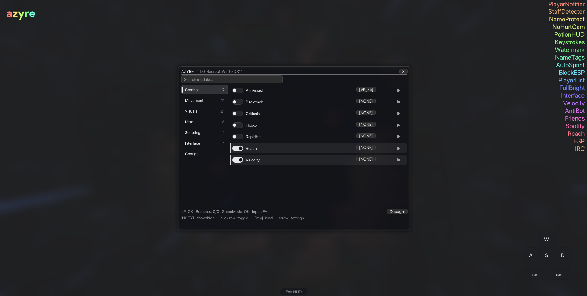
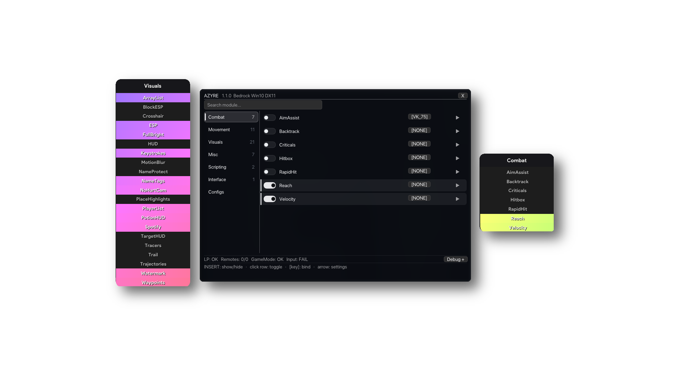
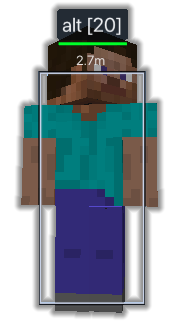
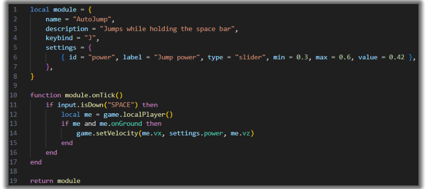

<div align="center">

# Azyre Client

**A lightweight, open-source Minecraft: Bedrock Edition (Windows 10/11) client — engineered for performance, stability, and extensibility.**

[](https://en.cppreference.com/w/cpp/20)
[](https://learn.microsoft.com/windows/win32/direct3d11/dx-graphics-overviews)
[](https://www.microsoft.com/windows)
[](https://cmake.org/)
[](LICENSE)
[](https://github.com/AnarchDevelopment/AzyreDll/releases)
[](https://github.com/AnarchDevelopment/AzyreDll/actions/workflows/cmake-on-windows.yml)

</div>

## Overview

Azyre Client is a from-scratch engineered client for **Minecraft: Bedrock Edition (Windows 10/11)**, developed by the **An4rch Development** team. It is built around a modular architecture that decouples game internals from feature logic, keeping the codebase clean, fast, and maintainable.

The client is designed around four first principles:

- **Modularity** — every feature is a self-contained module with its own lifecycle hooks, settings, and persistence.
- **Data-oriented design** — an [EnTT](https://github.com/skypjack/entt)-based ECS synchronizes game state (players, blocks, projectiles) so modules never touch raw offsets directly.
- **Extensibility** — first-class [Luau](https://luau.org) scripting with a declarative settings API and a native drawing/game API.
- **Modern rendering** — DirectX 11 overlay with an immediate-mode ImGui UI, including a GPU-accurate acrylic/glass blur pipeline.

> **Disclaimer:** This project is intended for educational and research purposes. Use it responsibly and in compliance with the terms of service of any platform you interact with.

<div align="center">
  
  <p><em>The Azyre Client overlay — modular, blurred, and scriptable.</em></p>
</div>

---

## Showcase

| Menu | ESP | Scripts |
|:--:|:--:|:--:|
|  |  |  |

A fully-featured module library, modern blur rendering, and an embeddable Lua interpreter empower endless customization.

---

## Table of Contents

- [Overview](#overview)
- [Showcase](#showcase)
- [Technology Stack](#technology-stack)
- [Integrated Libraries](#integrated-libraries)
- [Project Structure](#project-structure)
- [Design Principles](#design-principles)
- [Module System](#module-system)
- [Dot-Commands](#dot-commands)
- [Scripting](#scripting)
- [Quick Start](#quick-start)
- [Building](#building)
- [Configuration](#configuration)
- [Roadmap](#roadmap)
- [Contributing](#contributing)
- [License](#license)
- [Contact](#contact)

---

## Technology Stack

| Technology | Version | Description |
|------------|---------|-------------|
| **C++** | 20 | Modern standard for performance and safety |
| **DirectX** | 11 | Rendering API used for the overlay and effects |
| **CMake** | 3.25+ | Build system and dependency management |
| **Windows** | 10 / 11 (x64) | Target platform |
| **Toolchains** | MSVC, Clang-CL, MinGW-w64 | Supported C++ compilers (see [Building](#building)) |

---

## Integrated Libraries

Dependencies are fetched automatically through CMake `FetchContent` — no manual setup required.

| Library | Purpose |
|---------|---------|
| **Dear ImGui** | Fast, lightweight immediate-mode UI |
| **nlohmann/json** | JSON serialization for configuration and presets |
| **MinHook** | Minimal x64 API hooking (trampolines) |
| **Luau** | Sandboxed scripting VM and compiler |
| **SoLoud** | Audio playback for UI feedback and alerts |
| **EnTT** | Entity-Component-System powering the game-state ECS |
| **C++/WinRT** | Windows Runtime interop (core window, storage) |

---

## Project Structure

```
src/
├── Commands/        Dot-commands (bind, binds, config, friend, help, irc, prefix, script, toggle)
├── Config/          JSON configuration, presets, and global settings
├── Features/        ECS, friends, bot filter, smoothing, raycasting, world chunks, HUD registry
├── Framework/       Hooking, memory, logging, math, sound, compat layer
├── GUI/             Menu, widgets, and theme
├── Input/           Input system, wheel/mouse hooks, keybinds
├── Modules/         Feature modules (Combat / Movement / Visuals / Misc / Interface)
├── Networking/      IRC bridge and Spotify service
├── Render/          DX11 Present hook, BlurHelper, EffectSprites, ResourceSprites, D2D backend
├── SDK/             Game SDK: offsets, vtables, classes, code patches, effects hook
└── Scripting/       Luau runtime and native bindings
```

---

## Design Principles

| Principle | How it's enforced |
|-----------|-------------------|
| **Separation of concerns** | Game internals live in `SDK/` and `Features/`; feature logic lives in `Modules/`. Modules never read raw offsets directly — they go through the ECS. |
| **Fail-safe isolation** | Module lifecycle hooks are guarded. A faulty module is disabled rather than crashing the process. |
| **Compiler portability** | MSVC-specific SEH is remapped transparently via `Framework/Compat.hpp`. All three supported toolchains must compile cleanly. |
| **Dependency hygiene** | All third-party libraries are fetched through CMake `FetchContent` — no manual setup, no vendored binaries. |
| **Runtime configurability** | Modules, keybinds, presets, and HUD layouts are JSON-driven and reloaded on the fly. |

---

## Module System

Each module lives in its own folder, implements a shared `Module` interface, and can be toggled independently at runtime or through configuration. Lifecycle hooks (`onEnable`, `onTick`, `onFrame`, `onRender`, `onShutdown`) are guarded so a faulty module is isolated rather than crashing the process. Modules are registered statically via `MC_REGISTER_MODULE`.

### Combat

| Module | Description |
|--------|-------------|
| **AimAssist** | Smoothly assists aiming toward the nearest valid target |
| **Backtrack** | Hits against lag-compensated (historical) target positions |
| **Criticals** | Forces critical hits by manipulating ground state |
| **Hitbox** | Expands attack hitboxes via a code patch |
| **RapidHit** | Bypasses the attack cooldown |
| **Reach** | Extends interaction/attack range |
| **Velocity** | Reduces or cancels incoming knockback |

### Movement

| Module | Description |
|--------|-------------|
| **AntiVoid** | Pushes you back before falling into the void |
| **AutoSprint** | Automatically sprints |
| **Flight** | Multi-mode flight (Motion / Pregame / Jump) |
| **Glide** | Reduces fall speed |
| **HighJump** | Increases jump height |
| **InventoryWalk** | Allows movement while an inventory is open |
| **LongJump** | Extends horizontal jump distance |
| **NoFall** | Prevents fall damage |
| **NoSlow** | Removes slowdown from items and effects |
| **Scaffold** | Automatically places blocks under your feet while walking (Stairs / Full / Down / Bottomless) |
| **Speed** | Movement speed boosts (Friction / Legit modes) |

### Visuals

| Module | Description |
|--------|-------------|
| **ArrayList** | On-screen list of enabled modules (multiple styles) |
| **BlockESP** | Highlights ores and special blocks (diamonds, emeralds, chests, spawners, …) through walls via chunk scanning |
| **Crosshair** | Custom crosshair |
| **ESP** | 2D/3D boxes highlighting players through walls |
| **FullBright** | Maximum brightness in dark areas |
| **HUD** | On-screen player information |
| **Keystrokes** | Animated WASD/mouse key display |
| **MotionBlur** | Ghost-frame motion blur |
| **NameProtect** | Replaces your name in-game (streaming-friendly) |
| **NameTags** | Floating name tags with health |
| **NoHurtCam** | Disables the hurt camera shake |
| **PlaceHighlights** | Fading highlight on blocks you place |
| **PlayerList** | TAB-style player overlay with Steve heads, health bars, and Azyre-user gradient highlighting |
| **PotionHUD** | Animated active-effects display with effect sprites |
| **Spotify** | "Now playing" widget (OAuth + album art) |
| **TargetHUD** | Information card for the current target |
| **Tracers** | Lines pointing to players |
| **Trajectories** | Predicts the arc of a thrown/held projectile |
| **Trail** | Leaves a trail behind the player |
| **Watermark** | Client watermark with FPS |
| **Waypoints** | Saveable points of interest with per-server profiles, tracers, and labels |

### Misc

| Module | Description |
|--------|-------------|
| **AntiAFK** | Prevents inactivity kicks |
| **AntiBot** | Filters bots/NPCs/holograms from ESP and targeting |
| **AutoTool** | Switches to the best tool for the block you are mining |
| **Friends** | Friend list management (middle-click to toggle) |
| **IRC** | In-game bridge to an IRC channel |
| **PlayerNotifier** | Join/leave/death/under-attack alerts |
| **StaffDetector** | Priority alerts when a staff member enters range |

### Interface

| Module | Description |
|--------|-------------|
| **Interface** | Appearance settings (style, theme, accent, font, rounding) |
| **sAzyre** | Classic Azyre menu style |
| **sSolstice** | Modern Solstice menu style |

---

## Dot-Commands

In-game commands are entered via the chat box with a configurable prefix (default `.`). Each command is self-contained and registered through a shared `Command` interface.

| Command | Description |
|---------|-------------|
| **`.bind <module> <key>`** | Bind a keybind to a module |
| **`.binds`** | List all active keybinds |
| **`.config <save\|load\|list> [name]`** | Manage configuration presets |
| **`.friend <add\|remove\|list> [name]`** | Manage the friend list |
| **`.help`** | Show available commands |
| **`.irc <join\|leave\|msg\|nick>`** | IRC bridge control |
| **`.prefix <char>`** | Change the command prefix |
| **`.script <reload\|list\|remove> [name]`** | Manage Luau scripts |
| **`.toggle <module>`** | Toggle a module on/off |

---

## Scripting

Azyre Client exposes a sandboxed **Luau** runtime. Each script runs in its own VM and returns a module table with metadata (`name`, `description`, `keybind`) and declarative `settings`. Scripts can react to lifecycle events and interact with the game through a native API:

```lua
local module = {
    name = "Example",
    description = "A sample Azyre script",
    settings = {
        { type = "slider", id = "speed", label = "Speed", min = 0, max = 10, default = 5 },
        { type = "checkbox", id = "jump", label = "Auto jump", default = true },
    },
}

function module.onTick()
    if settings.jump and input.isDown(0x20) then
        game.setVelocity(0, 0.42, 0)
    end
    ui.notify("Example running")
end

return module
```

Exposed namespaces include `game`, `modules`, `ui`, `input`, `friends`, `chat`, and `draw`. Scripts live under `Scripts/` in the client's base directory and can be reloaded with `.script reload`.

---

## Quick Start

To get Azyre Client up and running, ensure you have the prerequisites (Windows 10/11 x64, CMake 3.25+, and a supported C++ toolchain — MSVC, Clang‑CL, or MinGW‑w64). Then follow the [Building](#building) guide for detailed step‑by‑step instructions.

---

## Building

### Prerequisites

- **Windows 10 or 11** (x64)
- **CMake 3.25 or newer**
- **Windows SDK** (with C++/WinRT headers)
- An x64 C++ toolchain — one of:
  - **Visual Studio 2022/2026** with the *Desktop development with C++* workload (MSVC)
  - **LLVM/Clang** (`clang-cl` toolset)
  - **MinGW-w64** (GCC, e.g. via MSYS2)

All third-party dependencies are downloaded automatically during the CMake configure step.

### Additional notes

#### Supported toolchains

The build is compiler-aware. The primary and fully-featured target is **MSVC**; the workflow also validates **Clang-CL** and **MinGW-w64 (GCC)** on every push.

| Toolchain | Configure command |
|-----------|-------------------|
| **MSVC** | `cmake -B build -G "Visual Studio 18 2026" -A x64` |
| **Clang-CL** | `cmake -B build -G "Visual Studio 18 2026" -A x64 -T ClangCL` |
| **MinGW GCC** | `cmake -S . -B build -G Ninja -DCMAKE_BUILD_TYPE=Release -DCMAKE_C_COMPILER=gcc -DCMAKE_CXX_COMPILER=g++` |

```bash
# Clang-CL
cmake -B build -G "Visual Studio 18 2026" -A x64 -T ClangCL
cmake --build build --config Release --parallel

# MinGW GCC (Ninja, single-config)
cmake -S . -B build -G Ninja -DCMAKE_BUILD_TYPE=Release ^
      -DCMAKE_C_COMPILER=gcc -DCMAKE_CXX_COMPILER=g++
cmake --build build --parallel
```

#### Compiler-specific behavior

- **MSVC / Clang-CL** compile with `/utf-8`, `/W3` and, on `cl.exe` only, `/MP`. Clang-CL is detected and does **not** receive `/MP` (which it rejects).
- **GCC / Clang (native)** use `-Wall -Wextra` and link with `-static -static-libgcc` so the produced DLL has no dynamic `libgcc`/`libstdc++`/`winpthreads` dependencies.
- **SEH portability:** MSVC-specific `__try`/`__except` guards are transparently remapped for non-MSVC compilers through `src/Framework/Compat.hpp` (included force-wide via `-include`). On MinGW, `__try` is a native keyword mapped to `try`, so `__except` becomes `catch (...)`.
- **WinRT is MSVC-only:** the C++/WinRT input and window-title integrations are compiled only under `_MSC_VER`. Non-MSVC builds use Win32 COM initialization and polling input; they are intended as **compile/CI validation**, not as injectable production builds.
- **D3DCompiler:** on MinGW the compiler import library is resolved from the Windows SDK (`d3dcompiler.lib` in `um/x64`), since MinGW ships no `d3dcompiler_47.a`.

#### CI

Continuous integration runs on every push and pull request to `main` via [`.github/workflows/cmake-on-windows.yml`](.github/workflows/cmake-on-windows.yml), building all three toolchains (MSVC, Clang-CL, MinGW GCC) on `windows-latest`.

#### Notes

- The Windows SDK's C++/WinRT include directory is auto-detected (Windows Kits path or registry); a warning is emitted if it cannot be found.
- Release is the recommended configuration. `Debug` is supported but produces substantially larger binaries.
- If the SDK is installed in a non-standard location, pass it via `-DCMAKE_PREFIX_PATH` or the appropriate `CMAKE_*_COMPILER`/include variables.

---

## Configuration

Runtime state is stored as JSON in the client's base directory:

```
<LocalAppData>/Packages/<Minecraft package>/LocalState/Azyre/
├── Configs/
│   ├── default.json     # All modules, keybinds, and settings
│   ├── settings.json    # Global client settings
│   └── Presets/         # Named configuration presets
├── hud.json             # HUD element positions
├── Scripts/             # Luau scripts
└── azyre_sdk.log        # Diagnostic log
```

> **Note:** The client resolves `LocalState` via WinRT at boot. If WinRT is unavailable (non-MSVC builds), it falls back to the `RoamingState` path.

Press **INSERT** to toggle the menu. Configuration is saved on close and when modules change.

---

## Roadmap

| Area | Status | Notes |
|------|--------|-------|
| **Luau scripting** | ✅ Live | Native game API, settings schema, `.script reload` |
| **IRC bridge** | ✅ Live | In-game chat bridge with Spotify service |
| **DX11 overlay** | ✅ Live | Acrylic/glass blur pipeline via BlurHelper |
| **Module system** | ✅ Live | 49 modules across Combat / Movement / Visuals / Misc / Interface |
| **Cross-toolchain CI** | ✅ Live | MSVC, Clang-CL, and MinGW GCC validated on every push |
| **Effect sprites** | ✅ Live | Lazy-loaded potion-effect icon atlas (`src/Render/EffectSprites.*`) |
| **World chunks** | 🔧 In progress | ECS-backed chunk tracking (`src/Features/WorldChunks.hpp`) |
| **D2D rendering** | 🔧 In progress | Direct2D backend under `src/Render/D2D/` |
| **Resource sprites** | 🔧 In progress | Sprite atlas system under `src/Render/ResourceSprites.*` |

See the [issue tracker](https://github.com/AnarchDevelopment/AzyreDll/issues) for the full backlog and roadmap.

---

## Contributing

Contributions are welcome! Please read the [CONTRIBUTING.md](CONTRIBUTING.md) guide before opening a pull request.

---

## License

This project is licensed under the terms of the **ADPSL 1.1** license. See the [LICENSE](LICENSE) file for full terms.

---

## Contact

| Platform | Contact |
|----------|---------|
| **Discord** | [nqtvyzer](https://discord.com/users/1461700187767570599) |
| **Website** | [an4rch Development](https://anarchdevelopment.github.io/) |
| **Repository** | [AnarchDevelopment/AzyreDll](https://github.com/AnarchDevelopment/AzyreDll) |

---

<div align="center">

**Azyre Client** — Built with precision by the an4rch Development team.

</div>
